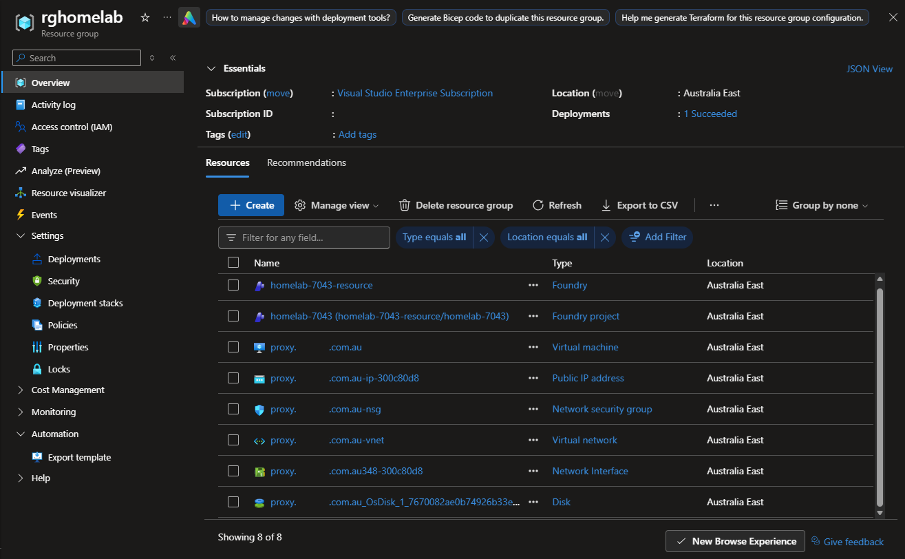

# Microsoft Azure

Resources in this RSG:

- Foundry AI models connected to Hermes Agent / OpenCode
- Virtual Machine running on Debian VM with Docker Container
- Netbird Proxy setup for public facing and Geoblocking capabilities
- NSG with SSH locked down to trusted IP address